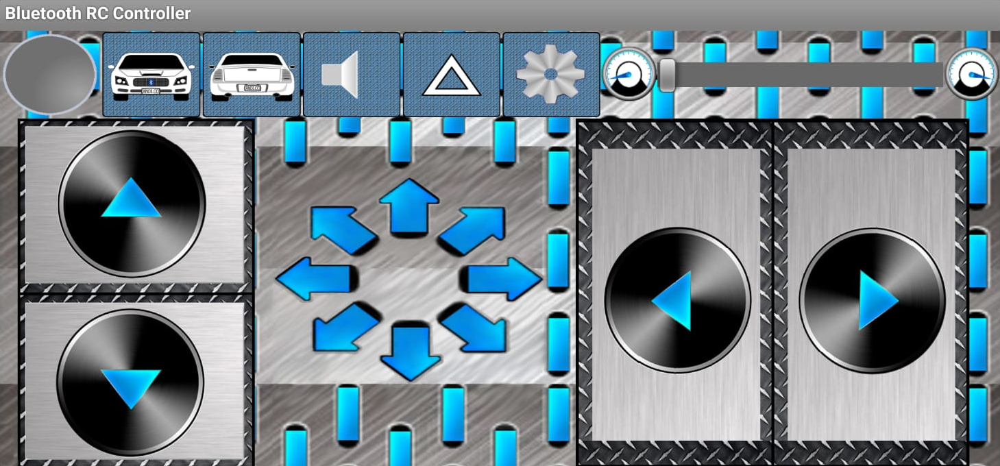
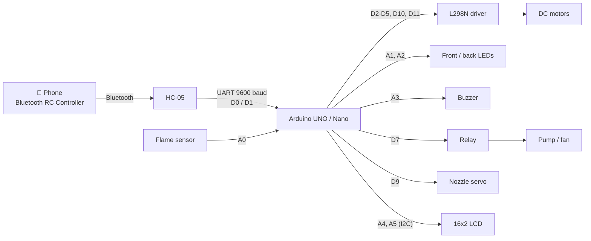
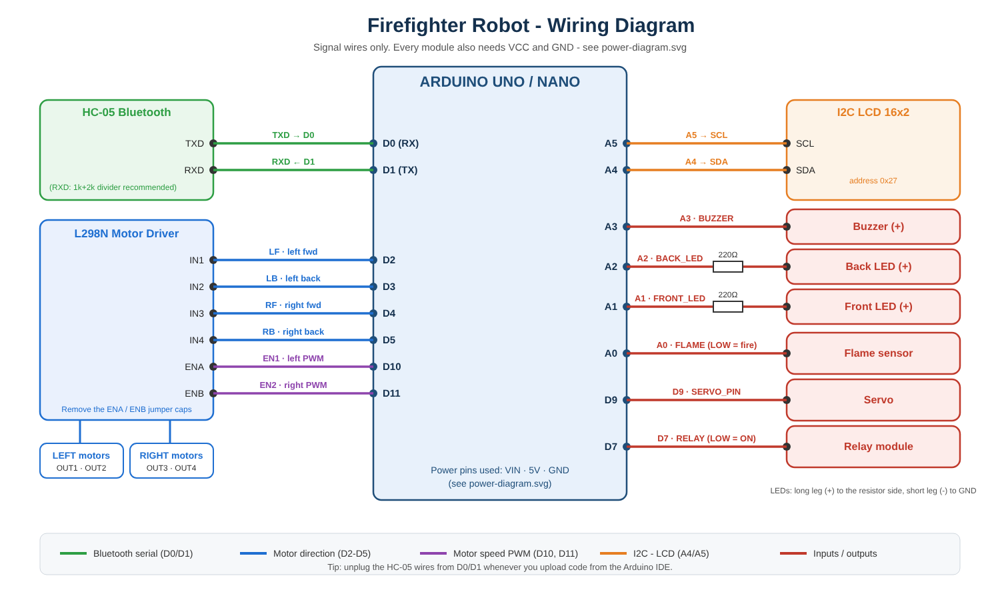
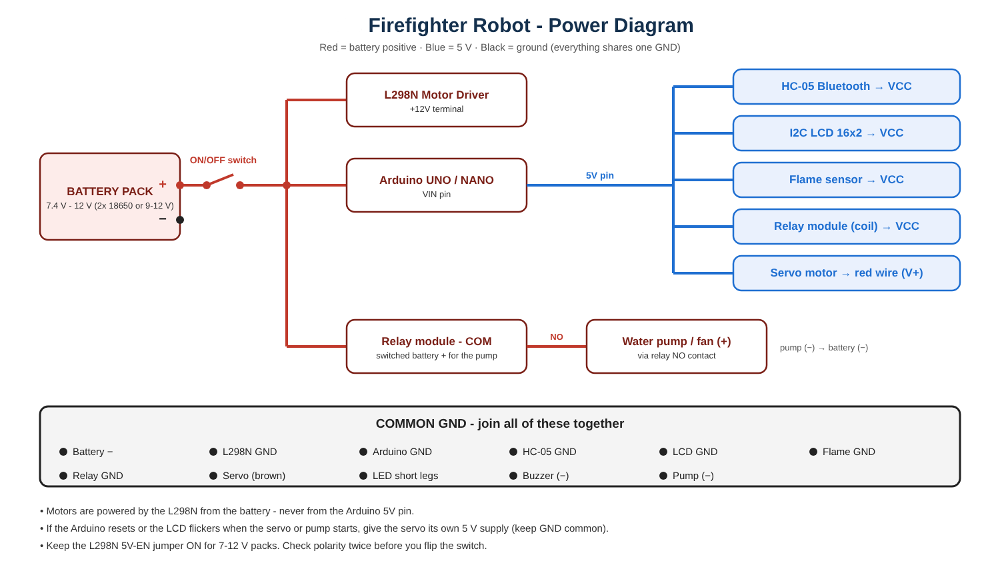
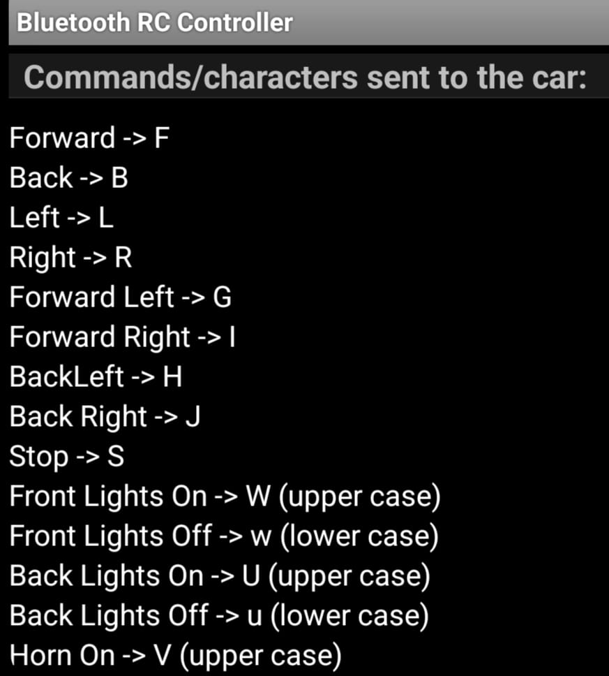
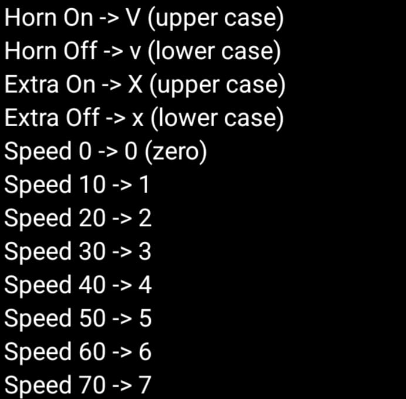
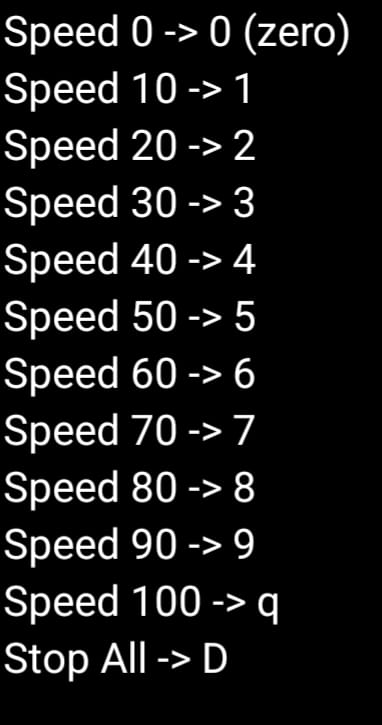

# 🔥 Firefighter Robot

A Bluetooth-controlled firefighting robot car built on Arduino. Drive it from your phone, switch the lights and horn, aim the extinguisher with a sweeping servo, and let the flame sensor warn you the moment fire is detected — with an alert on the LCD, a flashing LED and a buzzer.


<p align="center">
  
</p>

---

## Table of contents

1. [Features](#-features)
2. [How it works](#-how-it-works)
3. [Parts list](#-parts-list)
4. [Pinout](#-pinout)
5. [Circuit diagrams](#-circuit-diagrams)
6. [Build guide](#-build-guide)
7. [Upload the firmware](#-upload-the-firmware)
8. [Phone app setup](#-phone-app-setup)
9. [Controls](#-controls)
10. [Fire detection](#-fire-detection)
11. [Testing checklist](#-testing-checklist)
12. [Troubleshooting](#-troubleshooting)
13. [Customising](#-customising)
14. [Repository layout](#-repository-layout)
15. [Credits](#-credits)

---

## ✨ Features

- **Phone control over Bluetooth** — forward, back, left, right and stop.
- **11 speed levels** — from stopped to full power, set with the app slider.
- **Front light, back light and horn** — each with its own on/off button.
- **"Extra" output** — switches a relay (water pump or fan) and sweeps a servo from 0° to 180° so the nozzle covers a wide area.
- **Automatic flame alert** — the flame sensor triggers `Fire Alert !` on the LCD, a blinking LED and a buzzer.
- **Single sketch, no extra libraries beyond the LCD driver.**

---

## 🧠 How it works



The app sends **one character** for every button press (for example `F` for forward, `S` for stop). The Arduino reads that character from the Bluetooth module and runs the matching action. The sketch also checks the flame sensor continuously, so fire detection works whether or not you are pressing a button.

---

## 🧰 Parts list

| Qty | Part | Notes |
|:---:|------|-------|
| 1 | Arduino UNO (or Nano) | ATmega328P board with pins A0–A5 |
| 1 | HC-05 Bluetooth module | HC-06 also works |
| 1 | L298N dual motor driver | |
| 2–4 | DC gear motors + wheels | Two motors per side for a 4WD chassis |
| 1 | Chassis | 2WD or 4WD robot car kit |
| 1 | Flame sensor module | 3- or 4-pin module with a digital output (DO) |
| 1 | 16×2 LCD with I2C backpack | Address `0x27` (some use `0x3F`) |
| 1 | SG90 / MG90S servo | Sweeps the nozzle |
| 1 | 5 V relay module | Active-LOW (LOW switches it ON) |
| 1 | Mini water pump or fan | Switched by the relay |
| 2 | LEDs (front, back) | |
| 2 | 220 Ω resistors | One per LED |
| 1 | Active buzzer (5 V) | |
| 1 | Battery pack 7.4 V – 12 V | 2× 18650 in series works well |
| 1 | Power switch | |
| 1 | 1 kΩ + 2 kΩ resistor pair | Voltage divider for the HC-05 RXD pin |
| – | Jumper wires, breadboard or perfboard | |

---

## 📌 Pinout

### Arduino pin assignments

| Arduino pin | Connected to | Purpose | Notes |
|:-----------:|--------------|---------|-------|
| **D0 (RX)** | HC-05 **TXD** | Bluetooth receive | Unplug while uploading |
| **D1 (TX)** | HC-05 **RXD** | Bluetooth transmit | Use a 1k/2k divider; unplug while uploading |
| **D2** | L298N **IN1** | Left motors forward (`LF`) | |
| **D3** | L298N **IN2** | Left motors backward (`LB`) | |
| **D4** | L298N **IN3** | Right motors forward (`RF`) | |
| **D5** | L298N **IN4** | Right motors backward (`RB`) | |
| **D7** | Relay **IN** | Pump / fan (`RELAY_PIN`) | **LOW = ON**, HIGH = OFF |
| **D9** | Servo **signal** | Nozzle servo (`SERVO_PIN`) | Orange / yellow wire |
| **D10** | L298N **ENA** | Left motor speed (`EN1`) | Remove the ENA jumper cap |
| **D11** | L298N **ENB** | Right motor speed (`EN2`) | Remove the ENB jumper cap |
| **A0** | Flame sensor **DO** | Flame input (`FLAME_SENSOR`) | **LOW = fire detected** |
| **A1** | Front LED (+) via 220 Ω | Front light (`FRONT_LED`) | HIGH = ON |
| **A2** | Back LED (+) via 220 Ω | Back light (`BACK_LED`) | HIGH = ON |
| **A3** | Buzzer (+) | Horn / alarm (`BUZZER`) | HIGH = ON |
| **A4 (SDA)** | LCD **SDA** | I2C data | |
| **A5 (SCL)** | LCD **SCL** | I2C clock | |
| **5V** | Module VCC pins | 5 V supply | See [power diagram](#-circuit-diagrams) |
| **VIN** | Battery + (after switch) | Powers the Arduino | |
| **GND** | Common ground | | All grounds must be joined |

### L298N motor driver

| L298N terminal | Connects to |
|----------------|-------------|
| **OUT1, OUT2** | Left-side motors |
| **OUT3, OUT4** | Right-side motors |
| **+12V** | Battery + (after switch) |
| **GND** | Battery − / common GND |
| **IN1 – IN4** | D2, D3, D4, D5 |
| **ENA, ENB** | D10, D11 (jumper caps removed) |

> If a side spins the wrong way, swap that side's two motor wires on the L298N output terminals.

---

## 🔌 Circuit diagrams

### Signal wiring



### Power wiring



> 💡 The diagrams are also available as PNG files in [`assets/`](assets/) if you want to print them.

**Golden rules**

1. **One common ground.** Battery −, L298N GND, Arduino GND and every module GND must be connected together.
2. **Motors run from the battery through the L298N** — never from the Arduino 5 V pin.
3. **Check polarity** before connecting the battery. A reversed battery can destroy the Arduino and the driver.
4. If the Arduino resets or the LCD flickers when the servo or pump starts, give the servo its own 5 V supply (keep the grounds common).

---

## 🛠 Build guide

Work through these steps in order and test after each one. It is much easier to find a mistake when you have only added one thing since the last working test.

1. **Assemble the chassis.** Mount the motors and wheels, and fix the battery pack, L298N and Arduino to the base.
2. **Wire the motors.** Left-side motors to `OUT1/OUT2`, right-side motors to `OUT3/OUT4`. For a 4WD chassis, wire the two motors on the same side in parallel.
3. **Wire the L298N to the Arduino.** `IN1→D2`, `IN2→D3`, `IN3→D4`, `IN4→D5`, `ENA→D10`, `ENB→D11`. Remove the ENA/ENB jumper caps.
4. **Wire the power.** Battery + → switch → L298N `+12V` and Arduino `VIN`. Battery − → L298N `GND` and Arduino `GND`. Leave the switch OFF while wiring.
5. **Add the HC-05.** `VCC→5V`, `GND→GND`, `TXD→D0`, `RXD→D1` (through the 1k/2k divider).
6. **Add the LCD.** `VCC→5V`, `GND→GND`, `SDA→A4`, `SCL→A5`.
7. **Add the lights and buzzer.** Front LED on `A1`, back LED on `A2`, each in series with a 220 Ω resistor to GND. Buzzer `+` on `A3`, `−` to GND.
8. **Add the flame sensor.** `VCC→5V`, `GND→GND`, `DO→A0`. Point it forward, level with where the nozzle aims.
9. **Add the servo and relay.**
   - Servo: signal → `D9`, red → 5 V, brown → GND.
   - Relay module: `IN→D7`, `VCC→5V`, `GND→GND`.
   - Pump: battery + → relay **COM**, relay **NO** → pump +, pump − → battery −.
10. **Double-check everything** against the [pinout table](#-pinout), then continue to the firmware.

---

## 💻 Upload the firmware

### 1. Install the Arduino IDE

Download it from [arduino.cc/en/software](https://www.arduino.cc/en/software) and install it.

### 2. Install the LCD library

In the Arduino IDE open **Sketch → Include Library → Manage Libraries…**, search for **`LiquidCrystal I2C`** and install it.

`SPI`, `Wire` and `Servo` are built into the IDE — nothing else to install.

### 3. Open the sketch

Open [`FireFighter/FireFighter.ino`](FireFighter/FireFighter.ino).

### 4. Select board and port

- **Tools → Board →** *Arduino Uno* (or *Arduino Nano*)
- **Tools → Port →** the COM port of your Arduino
- Nano boards: **Tools → Processor →** *ATmega328P (Old Bootloader)* if the upload fails

### 5. Disconnect the Bluetooth module, then upload

The HC-05 shares pins **D0/D1** with the USB connection. **Unplug the HC-05 `TXD` and `RXD` wires** (or remove the module's power) before you click **Upload**, then plug them back in when the upload finishes.

If you did it right, the LCD shows:

```
firefighter
```

and then switches to the "Firefighter Robot" welcome screen.

---

## 📱 Phone app setup

The robot is driven with the free Android app **Bluetooth RC Controller** (search for the name in the Play Store).

1. **Pair the HC-05 in your phone's Bluetooth settings.** The device name is `HC-05` and the default PIN is `1234` (some modules use `0000`).
2. Open **Bluetooth RC Controller**.
3. Tap the **gear icon** (settings) and select the paired **HC-05** to connect.
4. Make sure the **baud rate is 9600** if the app offers that option — it must match the sketch.
5. Switch the robot ON. The HC-05 LED changes from fast blinking (searching) to a slow blink (connected).
6. Lift the wheels off the ground for the first test, then press **Forward**.

### Button map

<p align="center">
  
</p>

| App control | Character sent | What the robot does |
|-------------|:--------------:|---------------------|
| Big **▲** / cross **↑** | `F` | Drive forward |
| Big **▼** / cross **↓** | `B` | Drive backward |
| Big **◀** / cross **←** | `L` | Turn left (spins on the spot) |
| Big **▶** / cross **→** | `R` | Turn right (spins on the spot) |
| *Release any button* | `S` | Stop |
| **Front car** icon | `W` / `w` | Front LED on / off |
| **Rear car** icon | `U` / `u` | Back LED on / off |
| **Speaker** icon | `V` / `v` | Buzzer on / off |
| **Triangle** icon | `X` / `x` | Extra: relay (pump / fan) + servo sweep on / off |
| **Speed slider** | `0` – `9`, `q` | Set speed level |

> The four **diagonal arrows** in the middle of the app and the app's "Stop All" command are not used by this firmware. Use the four direction buttons.

<details>
<summary><b>📋 Full command list from the app (screenshots)</b></summary>
<br>

The app can send more characters than this robot uses. This firmware only reacts to the ones listed in the table above; everything else is ignored.

<p align="center">
  
  
  
</p>

</details>

---

## 🎮 Controls

### Driving

| Command | Character | Left motors | Right motors |
|---------|:---------:|:-----------:|:------------:|
| Forward | `F` | forward | forward |
| Backward | `B` | backward | backward |
| Left | `L` | backward | forward |
| Right | `R` | forward | backward |
| Stop | `S` | stop | stop |

### Speed levels

The robot starts at **full speed (255)**. The slider in the app steps through these levels:

| App speed | Character | PWM value (0–255) | Approx. power |
|:---------:|:---------:|:-----------------:|:-------------:|
| 0 | `0` | 0 | 0 % |
| 10 | `1` | 25 | 10 % |
| 20 | `2` | 50 | 20 % |
| 30 | `3` | 75 | 29 % |
| 40 | `4` | 100 | 39 % |
| 50 | `5` | 125 | 49 % |
| 60 | `6` | 150 | 59 % |
| 70 | `7` | 175 | 69 % |
| 80 | `8` | 200 | 78 % |
| 90 | `9` | 230 | 90 % |
| 100 | `q` | 255 | 100 % |

> Very low levels may not have enough power to move the robot — the exact threshold depends on your motors and battery charge.

### Lights, horn and extra

| Function | On | Off | Behaviour |
|----------|:--:|:---:|-----------|
| Front light | `W` | `w` | `A1` HIGH / LOW |
| Back light | `U` | `u` | `A2` HIGH / LOW |
| Horn | `V` | `v` | `A3` HIGH / LOW |
| Extra | `X` | `x` | `X`: relay ON (`D7` LOW) and servo sweeps 0°→180°→0°. `x`: relay OFF, servo returns to 90° |

---

## 🚨 Fire detection

The flame sensor module outputs **LOW when it sees a flame**.

| State | LCD | Buzzer / back LED |
|-------|-----|-------------------|
| Normal | `Firefighter Robot` | Under app control |
| Fire detected | `Fire Alert !` | Flash twice (300 ms on / 300 ms off), repeating while the flame is visible |

**Typical firefighting run**

1. Drive towards the flame until the alert appears.
2. Press **Triangle** (`X`) — the pump / fan starts and the servo sweeps the nozzle.
3. Press **Triangle** again (`x`) once the flame is out.

Adjust the sensor's blue potentiometer until the module's detection LED only lights for a real flame, not for room light.

> ⚠️ **Safety:** Test only with a small, safe flame such as a candle, with an adult present and a bucket of water nearby. Never use flammable liquids. This is an educational project, not a certified fire-safety device.

---

## ✅ Testing checklist

Run these tests with the wheels lifted off the ground.

| # | Test | Expected result |
|:-:|------|-----------------|
| 1 | Switch on | LCD lights up and shows `firefighter` |
| 2 | Pair and connect from the app | HC-05 LED blinks slowly |
| 3 | Press **Forward** | All wheels spin forward; release → stop |
| 4 | Press **Back / Left / Right** | Wheels spin in the expected directions |
| 5 | Move the **speed slider** | Wheel speed changes |
| 6 | **Front / rear car** icons | Matching LED turns on and off |
| 7 | **Speaker** icon | Buzzer sounds while pressed on |
| 8 | **Triangle** icon | Relay clicks, pump runs, servo sweeps; press again to stop |
| 9 | Hold a candle flame ~20 cm from the sensor | `Fire Alert !`, buzzer and back LED flash |

---

## 🩺 Troubleshooting

| Symptom | Likely cause | Fix |
|---------|--------------|-----|
| Upload fails (`avrdude: stk500_getsync`) | HC-05 connected to D0/D1, wrong board or wrong port | Unplug HC-05 `TXD`/`RXD`, re-check **Board** and **Port** |
| Compile error on `lcd.begin()` | Different version of the LCD library | Replace `lcd.begin();` with `lcd.init();` |
| App will not connect | Module not paired, or already connected to another phone | Pair in phone settings first (PIN `1234` / `0000`) |
| Connected but robot ignores buttons | `TXD`/`RXD` swapped, or baud rate not 9600 | HC-05 `TXD → D0` and `RXD → D1`; use 9600 baud |
| LCD is lit but shows no text | Contrast pot on the I2C backpack | Turn the small blue potentiometer with a screwdriver |
| LCD stays blank | Wrong I2C address | Run an I2C scanner; if it reports `0x3F`, change `LiquidCrystal_I2C lcd(0x27, 16, 2)` |
| One side spins backward | Motor wires reversed on that side | Swap that side's two wires on the L298N |
| Left and right swapped | Left/right motor outputs swapped | Swap `OUT1/OUT2` with `OUT3/OUT4` |
| Motors hum but do not move | Speed level too low, or the battery is flat | Raise speed (slider to 100) and charge the battery |
| Arduino resets when the servo or pump starts | Not enough current from the 5 V rail | Power the servo from a separate 5 V supply with common GND |
| Relay is always ON at power-up | Relay module is active-HIGH | Swap the `HIGH`/`LOW` values for `RELAY_PIN` in the sketch |
| `Fire Alert !` appears with no flame | Sensor too sensitive, or bright light | Turn the sensor potentiometer; shield it from sunlight |
| No alert even with a flame | Sensor too far or pointing away | Move within 20–30 cm and aim at the flame |

---

## 🔧 Customising

All pin numbers are defined at the top of [`FireFighter.ino`](FireFighter/FireFighter.ino):

```cpp
#define LF 2      // left motors forward
#define LB 3      // left motors backward
#define RF 4      // right motors forward
#define RB 5      // right motors backward

#define EN1 10    // left speed (PWM)
#define EN2 11    // right speed (PWM)

#define RELAY_PIN 7
#define SERVO_PIN 9

#define FRONT_LED A1
#define BACK_LED  A2
#define BUZZER    A3
#define FLAME_SENSOR A0
```

- **Change the speed steps** — edit the `case '1' … case 'q'` lines in `processCommand()`.
- **Change the servo sweep speed** — edit `servoStep` (degrees per step) or the `20` ms delay in the servo timer inside `loop()`.
- **Change the LCD text** — edit the strings in `setup()` and `flameCheck()`.

---

## 📁 Repository layout

```
.
├── README.md
├── FireFighter/
│   └── FireFighter.ino      # Arduino sketch
└── assets/
    ├── app-controller.jpg        # App screenshot
    ├── app-commands-1.jpg        # App command list (1/3)
    ├── app-commands-2.jpg        # App command list (2/3)
    ├── app-commands-3.jpg        # App command list (3/3)
    ├── wiring-diagram.png        # Signal wiring
    └── power-diagram.png         # Power wiring
```

---

## 🙌 Credits

- Project: **Firefighter Robot**
- Firmware: **sanjuu**
- Phone app: *Bluetooth RC Controller*

Add a `LICENSE` file (for example MIT) before publishing to make clear how others may use this project.
